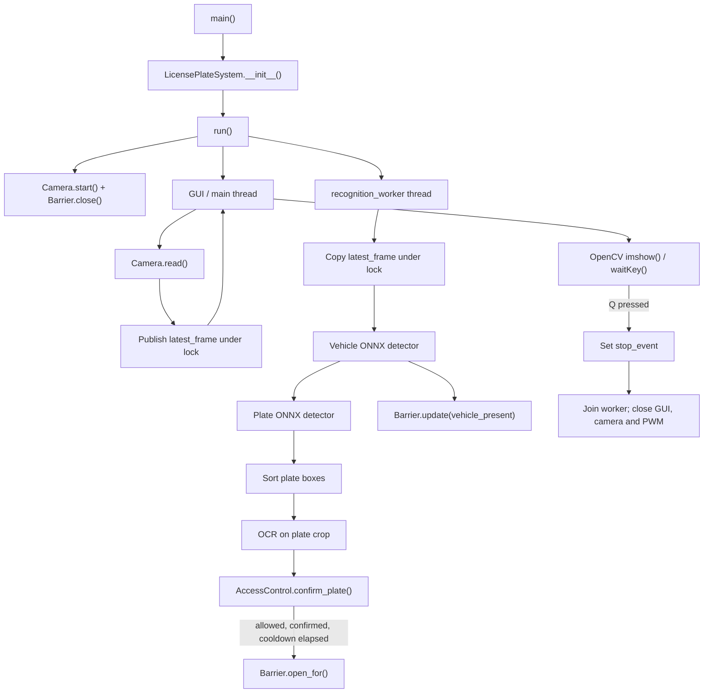

# Архитектура RPI-Plate-Recognition

Документ описывает состояние ветки `main` и сверён с файлами репозитория. Основной runtime находится в `barrier/src/`; вспомогательный Windows-подпроект — в `barrier/windows/`.

## 1. Назначение и границы системы

Основной сценарий: камера получает изображение → детекторы находят транспорт и номер → OCR преобразует crop номера в строку → AccessControl проверяет строку по whitelist и правилам подтверждения → Barrier управляет сервоприводом.

Компоненты не являются системой промышленной безопасности. В проекте нет датчика положения стрелы, концевых выключателей, фотоэлемента/индукционной петли, контроля защемления или аппаратного аварийного контура. Присутствие транспортного средства определяется только компьютерным зрением.

## 2. Фактическая структура репозитория

```text
.
├── README.md
├── Architecture.md
├── requirements.txt
├── requirements-model-tools.txt
├── .gitignore
└── barrier/
    ├── config/
    │   ├── settings.yaml
    │   └── allowed_plates.txt
    ├── models/
    │   ├── license-plate-finetune-v1l.onnx
    │   ├── license-plate-finetune-v1m.onnx
    │   ├── license-plate-finetune-v1m.pt
    │   ├── license-plate-finetune-v1n.onnx
    │   ├── license-plate-finetune-v1n.pt
    │   ├── license-plate-finetune-v1s.onnx
    │   ├── yolov8n.onnx
    │   └── yolov8n.pt
    ├── src/
    │   ├── __init__.py
    │   ├── access_control.py
    │   ├── barrier.py
    │   ├── camera.py
    │   ├── detector.py
    │   ├── logger.py
    │   ├── main.py
    │   └── ocr.py
    ├── tests/
    │   ├── test_access_control.py
    │   └── test_plate_normalization.py
    └── windows/
        ├── .gitignore
        ├── README.md
        ├── config/settings.yaml
        ├── dataset/
        │   ├── images/1.jpg ... 4.jpg
        │   └── labels.csv
        ├── requirements.txt
        ├── src/
        │   ├── __init__.py
        │   ├── detector.py
        │   ├── evaluate.py
        │   ├── main.py
        │   └── ocr.py
        └── tests/
            ├── __init__.py
            ├── test_normalization.py
            ├── test_ocr.py
            ├── test_ocr_1.py
            └── test_rectification.py
```

Ветка `main` содержит все перечисленные восемь model-файлов. Размеры файлов из Git tree:

| Файл | Размер |
|---|---:|
| `license-plate-finetune-v1l.onnx` | 101,390,463 bytes |
| `license-plate-finetune-v1m.onnx` | 80,308,089 bytes |
| `license-plate-finetune-v1m.pt` | 40,507,749 bytes |
| `license-plate-finetune-v1n.onnx` | 10,481,682 bytes |
| `license-plate-finetune-v1n.pt` | 5,465,235 bytes |
| `license-plate-finetune-v1s.onnx` | 37,805,310 bytes |
| `yolov8n.onnx` | 12,851,106 bytes |
| `yolov8n.pt` | 6,549,796 bytes |

Размеры — значения Git tree, а не измерения локальной файловой системы. В runtime используются только `license-plate-finetune-v1n.onnx` и `yolov8n.onnx`, заданные в YAML. PT-файлы не загружаются приложением.

Каталоги `barrier/data/` и `barrier/windows/results/` создаются во время работы и отсутствуют в исходном дереве. Виртуальные окружения, кэш Python и результаты исключены через gitignore.

## 3. Runtime-компоненты и функции

### 3.1 `barrier/src/main.py` — LicensePlateSystem

**Константы модуля**
- `PROJECT_DIR`: вычисляется как родительский каталог `src`, то есть `barrier/`.
- `CONFIG_PATH`: `barrier/config/settings.yaml`.

**`LicensePlateSystem.__init__()`**
- Создаёт логгер и загружает YAML.
- Читает `display.enabled` (по умолчанию true).
- Инициализирует Camera с заданными width/height.
- Проверяет существование plate detector model и создаёт PlateDetector.
- Проверяет существование vehicle detector model и создаёт второй PlateDetector с class IDs (2, 3, 5, 7).
- Выбирает OCR backend по `ocr.backend`: FastPlateOCR или PlateOCR/Tesseract; неизвестное значение приводит к ValueError.
- Проверяет файл whitelist и создаёт AccessControl.
- Создаёт Barrier с PWM-настройками, углами, длительностью и необязательными точными импульсами.
- Считывает processing interval.
- Создаёт lock, event и разделяемые поля последнего кадра, детекций и распознанного текста.

**`load_config()`**
- Статический метод, проверяет наличие CONFIG_PATH и загружает YAML через `yaml.safe_load`.

**`recognition_worker()`**
- Работает в отдельном daemon thread до установки stop_event.
- Берёт копию последнего кадра под frame_lock; если кадра ещё нет, ждёт 50 ms.
- Последовательно запускает детектор транспорта и детектор номеров; записывает общее время обоих детекторов.
- Публикует результаты детекции для GUI.
- Сортирует номера по confidence.
- Передаёт флаг наличия транспорта в Barrier.update().
- Перебирает боксы номеров, ограничивает координаты размерами кадра, пропускает пустые crop.
- Вызывает OCR и отдельно логирует длительность OCR.
- При непустом результате логирует номер и confidence, обновляет отображаемую строку.
- Вызывает AccessControl.confirm_plate(); при True логирует ACCESS GRANTED и вызывает неблокирующий Barrier.open_for().
- После первого непустого OCR прекращает обработку боксов в текущем цикле.
- Если номер не распознан, передаёт пустую строку в AccessControl, сбрасывая последовательность подтверждений.
- Исключения одного цикла логируются, затем поток продолжает работу после processing interval.

**`run()`**
- Проверяет GUI-поддержку OpenCV и наличие DISPLAY/WAYLAND_DISPLAY, если GUI включён.
- Создаёт окно OpenCV, запускает камеру и закрывает шлагбаум.
- Стартует recognition_worker.
- В основном потоке непрерывно читает кадры камеры, обновляет shared frame и отображает live video с рамками транспорта/номеров и последним распознанным текстом.
- Выход по Q или Ctrl+C.
- В finally выставляет stop_event, ждёт worker до 5 секунд, закрывает GUI, камеру и PWM/шлагбаум.

**`main()`**
- Создаёт LicensePlateSystem и запускает run().
- Вызывается при запуске `python -m src.main`.

### 3.2 `barrier/src/camera.py` — Camera

- `__init__(width, height)`: сохраняет размер и пустую ссылку на Picamera2.
- `start()`: создаёт Picamera2, конфигурирует video stream RGB888 с buffer_count=2, запускает камеру и ждёт секунду для автоэкспозиции.
- `read()`: требует запущенную камеру, захватывает массив RGB и преобразует его в BGR через OpenCV.
- `stop()`: останавливает и закрывает камеру, сбрасывает ссылку.

### 3.3 `barrier/src/detector.py` — PlateDetector

Один класс используется для двух ONNX моделей: plate detection и vehicle detection.

- `__init__(model_path, input_size, confidence, nms_threshold, class_ids)`: создаёт ONNX Runtime InferenceSession с CPUExecutionProvider, сохраняет имя входа и параметры фильтрации.
- `detect(frame)`: вычисляет масштаб letterbox, изменяет размер кадра с сохранением пропорций, дополняет квадратное полотно значением 114, строит нормализованный NCHW blob, запускает ONNX inference и передаёт выход парсеру.
- `_parse_output(...)`: поддерживает выход N×6 (xyxy, score, class_id) и сырой YOLO-выход [4+C,N] / [N,4+C]. Применяет class_ids, confidence threshold и OpenCV NMS. Переводит координаты обратно в исходное изображение, обрезает их границами кадра и возвращает список `(x1, y1, x2, y2, confidence)`.

Для vehicle detector передаются class IDs COCO: 2 car, 3 motorcycle, 5 bus, 7 truck. Для plate detector class_ids не ограничиваются.

### 3.4 `barrier/src/ocr.py` — PlateOCR и FastPlateOCR

Общие функции/константы:
- `PLATE_LETTERS` и `PLATE_PATTERN`: формат одной буквы, трёх цифр, двух букв; разрешённые буквы соответствуют российскому формату.
- `CYRILLIC_TO_LATIN`: таблица визуально совпадающих кириллических букв.
- `DIGIT_MAP` и `LETTER_MAP`: контекстные замены похожих символов.
- `WHITELIST`: символы, разрешённые Tesseract.
- `PSM_MODES`: набор режимов для диагностического/вариантного распознавания.

**PlateOCR**
- `__init__(language, min_confidence)`: сохраняет параметры Tesseract.
- `normalize(text)`: переводит в верхний регистр, заменяет визуально совпадающую кириллицу и удаляет всё, кроме латинских букв/цифр.
- `extract_plate(text)`: ищет шестисимвольный фрагмент; исправляет похожие символы в позициях буквы/цифры и проверяет PLATE_PATTERN.
- `add_border(image)`: добавляет белую рамку.
- `preprocess(plate_image)`: создаёт 8 вариантов (увеличение, CLAHE, Otsu, adaptive threshold, sharpening, inverted Otsu) — вспомогательный тяжёлый путь для анализа.
- `recognize_variant(image, psm)`: один вызов Tesseract image_to_data, фильтрует слова по confidence и возвращает raw text, найденный номер и среднюю уверенность.
- `recognize_variants(image)`: прогоняет 8 вариантов по 4 PSM (до 32 вызовов), выбирает результат по числу совпадений и средней уверенности.
- `recognize(plate_image)`: оптимизированный runtime путь: проверяет crop, переводит в grayscale, умеренно увеличивает, применяет blur и Otsu, добавляет border и выполняет максимум два вызова Tesseract (PSM 7 и 8). Возвращает первый валидный номер либо пустую строку.

**FastPlateOCR**
- `__init__(model_name, device)`: импортирует ONNXPlateRecognizer из fast-plate-ocr и загружает указанную Hub-модель на выбранное устройство.
- `recognize(plate_image)`: проверяет crop, переводит BGR в grayscale при необходимости, вызывает model.run() и нормализует первый результат через PlateOCR.extract_plate(). Возвращает пустую строку, если вход пуст или предсказаний нет.

В текущем YAML активен FastPlateOCR 0.3.x, модель `global-plates-mobile-vit-v2-model`, CPU. Tesseract остаётся альтернативным backend. Наличие кода не означает, что точность глобальной модели на конкретном российском датасете уже подтверждена.

### 3.5 `barrier/src/access_control.py` — AccessControl

- `__init__(allowed_plates_file, required_confirmations, cooldown_seconds)`: нормализует параметры, загружает whitelist, инициализирует last_plate, confirmation_count и last_open_time.
- `normalize(plate)`: classmethod; верхний регистр, кириллица → латиница для визуально совпадающих символов, удаление пробелов/разделителей и прочих не буквенно-цифровых знаков.
- `_load_allowed_plates()`: создаёт родительский каталог и файл при отсутствии, игнорирует пустые и comment-строки, возвращает set нормализованных номеров.
- `is_allowed(plate)`: проверяет нормализованный номер в whitelist.
- `confirm_plate(plate)`: неизвестный/пустой номер сбрасывает счётчик; одинаковые последовательные разрешённые номера увеличивают счётчик, смена номера начинает его заново. После достижения порога проверяется monotonic cooldown. Если cooldown истёк, метод сбрасывает последовательность, обновляет last_open_time и возвращает True.

Текущий whitelist содержит шесть записей: A123BC, B456CD, C789EF, C007CY, M777PO, O001OO. В YAML сейчас `required_confirmations: 1`, `cooldown_seconds: 1`.

### 3.6 `barrier/src/barrier.py` — HardwareServo и Barrier

**HardwareServo**
- `__init__(...)`: проверяет частоту, общий диапазон импульсов и период, сохраняет калибровку, создаёт rpi_hardware_pwm.HardwarePWM и запускает PWM на начальном угле.
- `_angle_to_duty(angle)`: линейно переводит угол 0–180° в duty cycle на основе min/max pulse width.
- `set_pulse_width_ms(pulse_width_ms)`: задаёт точную длительность импульса; проверяет, что она положительна и короче периода PWM.
- `angle` property: getter возвращает сохранённый угол; setter ограничивает угол диапазоном 0–180 и обновляет duty cycle.
- `close()`: останавливает PWM.

**Barrier**
- `__init__(...)`: сохраняет углы, длительность открытия и состояние, создаёт HardwareServo и переводит механизм в закрытое состояние.
- `open()`: применяет точный opened pulse, если он задан, иначе opened_angle; устанавливает close_at.
- `close()`: применяет closed pulse или closed_angle, сбрасывает состояние и таймер.
- `keep_open(duration)`: продлевает таймер только если шлагбаум уже открыт.
- `update(vehicle_present)`: ничего не делает при закрытом состоянии; при наличии транспорта продлевает таймер, иначе закрывает при истечении close_at.
- `open_for(duration)`: неблокирующее открытие с таймером.
- `stop()`: переводит механизм в закрытое положение и останавливает PWM.

В конфигурации частота 50 Hz, pwmchip 0, channel 1, BCM GPIO13. Явно заданные импульсы `closed_pulse_width_ms=2.35` и `opened_pulse_width_ms=1.5`. Точный импульс валидируется относительно PWM period (20 ms при 50 Hz), а не min/max диапазона, используемого преобразованием угла. Поэтому закрывающий импульс 2.35 ms может быть больше `max_pulse_width_ms=2.0` и всё равно принимается текущим кодом.

### 3.7 `barrier/src/logger.py` — setup_logger

- `setup_logger(name)`: создаёт `data/logs/`, настраивает INFO logger, консольный StreamHandler и RotatingFileHandler для `data/logs/barrier.log` (2,000,000 bytes, 3 backups). Если handlers уже существуют, возвращает существующий logger без дублирования.

### 3.8 `barrier/src/__init__.py`

Содержит docstring пакета runtime; самостоятельной логики нет.

## 4. Потоки исполнения и взаимодействие



Синхронизация кадров и последних результатов выполняется через один `threading.Lock`. GUI читает последний опубликованный набор детекций; worker не управляет GUI напрямую. Видеопоток не зависит от длительности инференса, но частота обновления результатов ограничена скоростью детекторов и `processing.interval_seconds`.

## 5. Текущая конфигурация runtime

| Параметр | Значение |
|---|---|
| Камера | 640×480, RGB888 на входе Picamera2 |
| Plate detector | `models/license-plate-finetune-v1n.onnx` |
| Vehicle detector | `models/yolov8n.onnx` |
| Plate input size | 640 |
| Plate confidence / NMS | 0.45 / 0.45 |
| Vehicle confidence / NMS | 0.35 / 0.45 |
| Vehicle class IDs | 2, 3, 5, 7 |
| OCR backend | `fast_plate_ocr` |
| OCR model | `global-plates-mobile-vit-v2-model` |
| OCR device | CPU |
| Confirmations / cooldown | 1 / 1 second |
| PWM | chip 0, channel 1, 50 Hz |
| Servo pulse closed / opened | 2.35 ms / 1.5 ms |
| Barrier open duration | 2 seconds |
| GUI | enabled |
| Processing interval | 0.5 seconds |

Значения отражают текущий файл YAML, не гарантируют фактическую производительность или механическую совместимость на другом устройстве.

## 6. Конфигурация и пути

- Все runtime-пути модели и whitelist в YAML заданы относительно `barrier/`, так как PROJECT_DIR — каталог `barrier`.
- Конфигурация загружается из `barrier/config/settings.yaml`.
- Whitelist: `barrier/config/allowed_plates.txt`.
- Логи: относительный путь `data/logs/barrier.log`; при стандартном запуске из `barrier/` это `barrier/data/logs/barrier.log`.
- Windows config paths вычисляются относительно `barrier/windows/`.

## 7. Windows-подпроект

Windows-часть — offline pipeline для проверки plate detector и Tesseract OCR на наборе размеченных изображений. Она не импортирует Raspberry Pi runtime и не включает GPIO/servo control.

### `barrier/windows/src/main.py`
- `load_config()`: загружает `config/settings.yaml`.
- `main()`: парсит `--show`, проверяет модель, папку изображений и labels CSV; создаёт PlateDetector, PlateOCR и DatasetEvaluator; запускает оценку. При `--show` последовательно показывает сохранённые annotated images.

### `barrier/windows/src/detector.py`
- `PlateDetector.__init__()`: создаёт ONNX Runtime CPU session, сохраняет input name и формат выхода.
- `detect(frame)`: letterbox preprocessing, ONNX inference, вызов parser, печать найденных боксов.
- `_parse(...)`: поддерживает конфигурируемые форматы `auto`, `nms`, `yolo`; применяет confidence, NMS, восстанавливает координаты crop.

### `barrier/windows/src/ocr.py`
- `normalize_plate()`: верхний регистр, кириллица → латиница, удаление разделителей.
- `extract_plate()`: извлечение номера по шаблону с позиционными заменами похожих символов.
- `PlateOCR.__init__()`: сохраняет язык/confidence и необязательный путь к tesseract.exe.
- `add_border()`: белое поле вокруг изображения.
- `preprocess()`: 8 вариантов изображения.
- `recognize_variant()`: один Tesseract проход, извлечение текста и confidence.
- `recognize()`: перебирает 8 вариантов × 4 PSM; если кандидатов нет, повторяет цикл для JPEG-копии качества 95; выбирает номер голосованием и confidence.

### `barrier/windows/src/evaluate.py`
- `calculate_iou(box_a, box_b)`: вычисляет Intersection over Union.
- `DatasetEvaluator.__init__()`: сохраняет зависимости/пути и создаёт results directory.
- `load_labels()`: читает CSV, требует image и plate, опционально читает x1/y1/x2/y2.
- `evaluate()`: загружает каждое изображение, запускает детектор и OCR для найденных crop, выбирает распознанный результат с максимальным detector confidence, считает exact match и IoU, сохраняет crops/annotated images и формирует строки результата.
- `save_results()`: записывает `results/results.csv`.
- `print_summary()`: выводит detection coverage, end-to-end exact OCR accuracy и IoU success для строк с ground-truth bbox.

### Windows tests и диагностические скрипты
- `tests/test_normalization.py`: pytest проверки нормализации и IoU.
- `tests/test_ocr.py`: самостоятельный диагностический запуск Tesseract по crop, вариантам предобработки и PSM; не unit-тест.
- `tests/test_ocr_1.py`: самостоятельный анализ яркости, компонент, порогов и Tesseract; не unit-тест.
- `tests/test_rectification.py`: содержит функции сглаживания, аппроксимации границ, выпрямления и batch-диагностики crop; основной сценарий запускается как скрипт. Он использует существующий PlateOCR без изменения OCR-алгоритма.
- `tests/__init__.py`: пакетный marker.

Dataset в Git содержит четыре изображения `1.jpg`–`4.jpg` и `labels.csv`. Windows README описывает пример CSV, метрики и отдельную установку Tesseract.

## 8. Runtime tests

`barrier/tests/test_access_control.py`:
- `test_allowed_plate`: разрешённый номер и отрицательная проверка неизвестного номера.
- `test_confirmation_required`: подтверждение только после заданного количества последовательных совпадений.
- `test_unknown_plate_resets_confirmation`: неизвестный номер сбрасывает счётчик.

`barrier/tests/test_plate_normalization.py`:
- `test_access_normalization`: нормализация в AccessControl.
- `test_ocr_normalization`: нормализация в PlateOCR.

Эти тесты не являются интеграционными тестами оборудования или точности моделей.

## 9. Зависимости

Корневой `requirements.txt`:
- numpy
- opencv-python (GUI build)
- onnxruntime
- pytesseract
- PyYAML
- huggingface_hub
- rpi-hardware-pwm
- fast-plate-ocr 0.3.x

`requirements-model-tools.txt` содержит Ultralytics только для экспорта модели на отдельном ПК.

`barrier/windows/requirements.txt` содержит numpy, opencv-python, onnxruntime, pytesseract, PyYAML и pytest. Windows-подпроект не устанавливает Raspberry Pi PWM package или FastPlateOCR.

## 10. Логирование и диагностика

Runtime logger пишет INFO в консоль и rotating file. В `main.py` измеряются:
- совместное время двух ONNX детекторов за один цикл;
- время OCR для обработанного crop;
- события распознанного номера и решения AccessControl.

Ошибки worker логируются с traceback, после чего цикл может продолжиться. Фатальные ошибки инициализации компонентов возникают при создании LicensePlateSystem; ошибки в run() логируются и приводят к очистке ресурсов.

## 11. Известные ограничения, требующие внимания

1. `required_confirmations: 1` в текущем YAML допускает открытие после одного успешного распознавания из whitelist.
2. Vehicle detector используется для продления уже открытого положения, но это не физический датчик проезда.
3. Runtime обрабатывает не более одного распознанного plate crop за цикл.
4. FastPlateOCR global model не гарантирует оптимальную точность на локальном формате номеров; требуется проверка на репрезентативном датасете.
5. Обработка YOLO идёт последовательно на CPU; GUI может обновляться чаще, чем результаты детекции.
6. Калибровка сервопривода зависит от экземпляра SG-90, питания и механической нагрузки.
7. В текущем коде точные импульсы closed/open проверяются относительно PWM периода, а не min/max pulse-width диапазона углов.
8. Автоматическое закрытие/удержание не заменяет аппаратные interlock, концевики и anti-crush.
